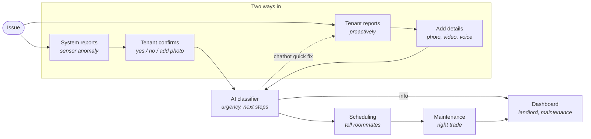
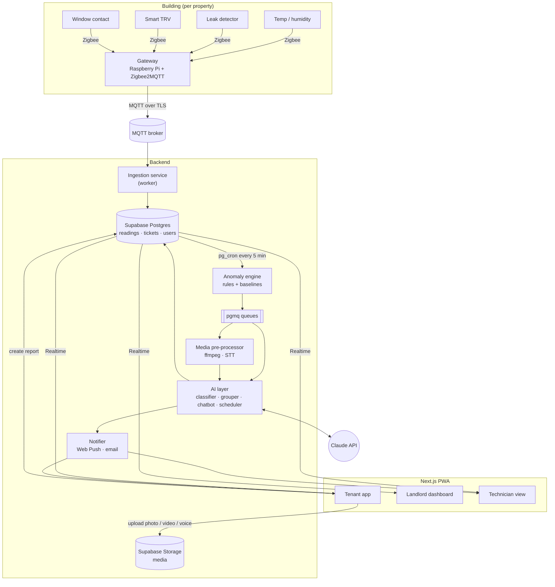
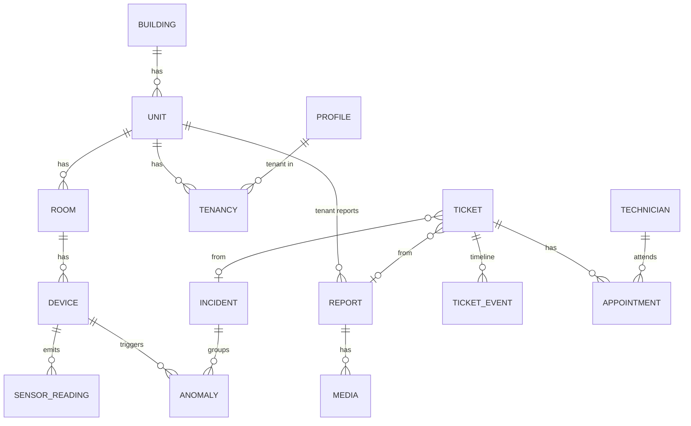
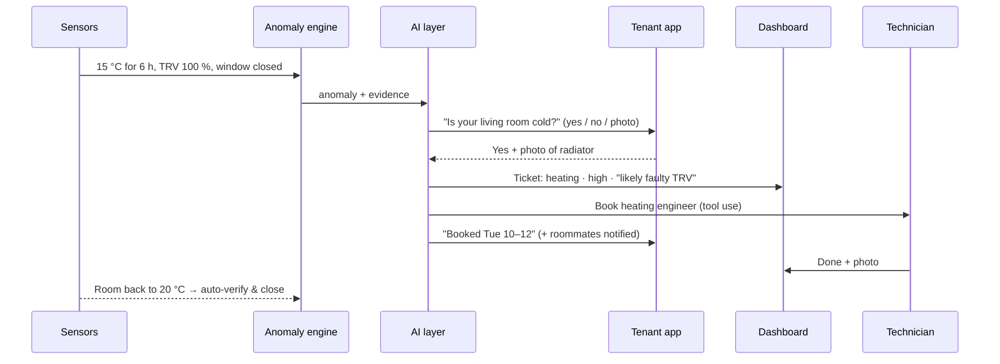

# Architecture & Tech Stack

> **Status:** proposal / v0.1. This document covers scope and technology choices.
> It follows the flow diagram below, but nothing here is final. Anything marked
> **Decision open** still needs the team to agree on it.

## 1. Problem & idea in one paragraph

Today, rental housing maintenance only happens after something goes wrong. Tenants email, wait, and never know when someone will come. Landlords get a pile of unstructured reports and only notice damage once it is expensive to fix. We give each building a "nervous system" of cheap IoT sensors and put an AI layer on top. The AI layer **detects** problems before anyone complains, **asks the tenant to confirm** them, **turns** any report (photo, video, voice) into a structured ticket, **groups** related issues across flats, and **acts** on them: it prioritises the ticket, books the right trade, and keeps everyone informed.

## 2. Flow (scope)



| Diagram box | Where it lives in the system | Section |
|---|---|---|
| System reports | Sensor ingestion + anomaly engine | §5.1, §5.2 |
| Tenant confirms | Confirmation prompt in the tenant app (push notification → yes / no / photo) | §5.3 |
| Tenant reports / Add details | Tenant PWA capture flow + media pre-processing | §5.3, §5.4 |
| AI classifier | `ai` package: triage, grouping, next steps | §5.4, §5.5 |
| Chatbot quick fix | Streaming chat in the tenant app, grounded in flat-specific guides | §5.6 |
| Scheduling | Booking service + roommate notifications | §5.7 |
| Maintenance | Technician app view, matched by trade | §5.7 |
| Dashboard | Landlord / property manager web dashboard (realtime) | §5.8 |

## 3. Stack at a glance

We use **one language (TypeScript) end to end**, so the whole team can work anywhere in the codebase. **Supabase** gives us database, auth, file storage, realtime, queues and cron in one managed service, which removes most of the backend boilerplate for a project this size.

| Layer | Choice | Why |
|---|---|---|
| Language | **TypeScript** (Node 22 LTS) | One language for web, worker and AI code; shared types for ticket schemas |
| Monorepo | **pnpm workspaces + Turborepo** | Shared `db`, `ai` and `ui` packages across apps |
| Web app (tenant + landlord + technician) | **Next.js (App Router)** as an installable **PWA** | One codebase, role-based views. A PWA can use the phone's camera and microphone without app-store releases |
| UI | **Tailwind CSS + shadcn/ui**, **Recharts** for sensor charts | Fast to build, accessible components |
| Database | **Supabase Postgres** (EU region) | Relational core + time-series readings in one place |
| Auth & access | **Supabase Auth** + Postgres **Row-Level Security** | Tenants only see their own flat, technicians only see tickets assigned to them |
| Media storage | **Supabase Storage** (private buckets, signed URLs) | Photos, videos, voice memos |
| Realtime | **Supabase Realtime** | Live dashboard and ticket status updates |
| Background jobs | **Supabase Queues (pgmq)** + **Supabase Cron (pg_cron)** | Durable job queue and schedules with no extra infrastructure |
| Worker service | **Node worker** (container on Fly.io / Railway) | Runs long jobs: anomaly scans, media processing (ffmpeg), AI calls |
| IoT transport | **MQTT** (Mosquitto, or EMQX Cloud free tier) | Industry standard, low-power, pub/sub |
| Sensor gateway | **Zigbee sensors → Zigbee2MQTT on a Raspberry Pi** per building | Cheap off-the-shelf sensors (temp/humidity, leak, window contact, TRVs) |
| LLM | **Claude API** (`@anthropic-ai/sdk`), model `claude-opus-5-5` | Vision for photos/video frames, structured outputs, tool use for booking |
| Speech-to-text | **Decision open:** hosted STT API (e.g. Deepgram) vs. self-hosted Whisper | Claude takes text, images and PDFs as input, not audio, so voice memos are transcribed first |
| Video processing | **ffmpeg** in the worker | Extracts keyframes plus the audio track from tenant videos |
| Notifications | **Web Push** (PWA) + **email via Resend**; SMS/WhatsApp later | Tenant confirmations, roommate notices, technician dispatch |
| Hosting | **Vercel** (web), **Supabase Cloud** (data), **Fly.io/Railway** (worker) | Free/cheap tiers are enough for a pilot |
| Observability | Sentry (errors), Supabase logs, a simple AI-call log table | Debug what the AI decided and why |

## 4. System architecture



**Principle:** sensors and rules **detect**, the LLM **interprets and acts**, humans **validate**. Deterministic code decides *whether* something is unusual (cheap, testable, explainable). Claude decides *what it probably means, how urgent it is, and what to do next*.

## 5. Components

### 5.1 Sensor ingestion

- **Hardware (pilot):** Zigbee temperature/humidity sensors, water-leak sensors, window/door contacts, and smart thermostatic radiator valves (TRVs). A Raspberry Pi with a Zigbee USB stick runs **Zigbee2MQTT**, which publishes JSON to the broker.
- **Topic scheme:** `building/{buildingId}/unit/{unitId}/room/{roomId}/{deviceType}/{deviceId}`
- **Ingestion service** subscribes to `building/#`, validates payloads with Zod, maps `deviceId → device row`, and batch-inserts into `sensor_readings` (every few seconds or every N messages).
- **Device health:** if a device has sent no message for more than 2× its reporting interval, the system raises a `device_offline` event. A dead sensor must never look like "everything is fine".
- **Simulator:** `tools/sensor-sim` publishes realistic fake data, including injected faults (stuck valve, leak, humidity creep). This lets us build and demo **without hardware**, so the demo does not depend on physical sensors.

### 5.2 Anomaly engine ("System reports")

Runs every 5 minutes (pg_cron → queue → worker). There are three tiers, cheapest first:

1. **Hard rules** (instant, no AI): leak sensor wet → `critical`. Temperature < 12 °C → `high`.
2. **Contextual rules** that combine several signals:
   - *Heating fault:* room < 17 °C for ≥ 3 h **and** TRV open ≥ 80 % **and** window closed → suspected valve or heating fault.
   - *Mould risk:* relative humidity > 70 % for most of the last 72 h (dew-point / "time-of-wetness" heuristic) → `medium`, preventive.
   - *Window open + heating on* for a long time → energy notice (informational only, never a ticket).
3. **Statistical baselines:** per-room rolling mean/standard deviation by hour of day; flag readings with |z| > 3 that persist across several readings.

**Cross-unit grouping:** before creating anything, the engine checks for **open anomalies of the same type that share a building, floor or heating circuit** within a time window. If, for example, six flats on floor 2 are cold at once, the engine creates **one `incident` with six linked anomalies**, not six tickets. The AI grouper (§5.5) then writes the hypothesis ("likely the boiler or floor-2 riser, not individual valves").

Every anomaly stores the **evidence** behind it (the readings and the rule that fired). The tenant prompt, the ticket and the dashboard all show this evidence.

### 5.3 Tenant app ("Tenant confirms" / "Tenant reports")

A **Next.js PWA** that tenants install to their home screen. No forms required.

- **Confirm flow** (sensor-initiated): a push notification says *"Your living room has been at 15 °C for 6 h with the heating on. Is it cold?"* The tenant answers **Yes / No / Add photo**.
  - *No* → the anomaly is marked as a false positive and fed back into the rule thresholds.
  - No answer within X hours → the system escalates anyway when the issue is `high` or `critical`.
- **Report flow** (tenant-initiated): one big button and three options. **Photo**, **video** (≤ 60 s) and **voice memo** use `getUserMedia` / `MediaRecorder`; an optional text note is also allowed. Uploads go straight to Supabase Storage. A `report` row is created and a job is queued.
- **Status timeline:** each ticket shows a timeline (received → classified → booked for Tue 10:00–12:00 → technician on the way → resolved), updated live through Realtime.
- **Rate feedback** after resolution. This closes the loop.

### 5.4 Media pre-processing ("Add details")

Claude takes text, images and PDFs as input, so the worker first converts every report into that form:

| Input | Processing | Sent to Claude as |
|---|---|---|
| Photo | Resize to ≤ 1568 px on the long edge, strip EXIF location | `image` block |
| Video | ffmpeg: ~1 keyframe per 2 s (max 8) + extract the audio track | several `image` blocks + transcript text |
| Voice memo | Speech-to-text (language auto-detected) | transcript text |
| Text note | — | text |

Raw media stays in Storage (private, signed URLs) for the technician. Only derived data goes to the LLM.

### 5.5 AI layer ("AI classifier")

All LLM code lives in `packages/ai`, so prompts, schemas and model settings are in one place. We use the official **Anthropic TypeScript SDK**.

| Job | Trigger | Input | Output | Claude features |
|---|---|---|---|---|
| **Report classifier** | New tenant report | Images, transcript, note, unit context (rooms, appliances, recent tickets) | Structured ticket (schema below) | Vision, **structured outputs** (`client.messages.parse` + Zod) |
| **Anomaly interpreter** | New anomaly / incident | Evidence readings, rule that fired, building topology, tenant confirmation | Hypothesis, urgency, tenant prompt text, ticket draft | Structured outputs |
| **Incident grouper** | Several related anomalies | Anomalies on the same floor/circuit | "One root cause?" judgement + merged ticket | Structured outputs |
| **Quick-fix chatbot** | Tenant opens chat, or classifier marks an issue `self_fixable` | Conversation + flat-specific guides | Streaming answer, or escalation to a ticket | Streaming, tool use |
| **Scheduler agent** | Ticket approved for dispatch | Ticket, technician pool, tenant/roommate availability | Booked appointment + notifications | **Tool use** (strict tools) |

**Ticket schema** (shared Zod type in `packages/ai/schemas.ts`, also used by the database layer):

```ts
const Ticket = z.object({
  category: z.enum(["heating", "plumbing", "leak", "electrical", "mould_damp",
                    "windows_doors", "appliance", "pest", "structural", "other"]),
  trade: z.enum(["plumber", "heating_engineer", "electrician", "carpenter",
                 "general_handyman", "pest_control", "damp_specialist"]),
  urgency: z.enum(["critical", "high", "medium", "low"]),   // see SLA table
  location: z.object({ unitId: z.string(), room: z.string(), detail: z.string() }),
  title: z.string(),                 // "Radiator not heating – living room"
  summary: z.string(),               // 2–3 sentences for landlord/technician
  likely_cause: z.string(),
  self_fixable: z.boolean(),         // route to chatbot quick fix first?
  safety_risk: z.boolean(),          // gas smell, exposed wiring, ... → never self-fix
  needs_access_to_unit: z.boolean(), // drives roommate notification
  confidence: z.number(),            // 0–1; low → ask tenant a follow-up question
  follow_up_question: z.string().nullable(),
});
```

**Classifier call (sketch):**

```ts
import Anthropic from "@anthropic-ai/sdk";
import { zodOutputFormat } from "@anthropic-ai/sdk/helpers/zod";

const client = new Anthropic();

const res = await client.messages.parse({
  model: "claude-opus-5-5",
  max_tokens: 4000,
  output_config: { effort: "low", format: zodOutputFormat(Ticket) },
  system: CLASSIFIER_SYSTEM_PROMPT,          // stable → prompt-cached
  messages: [{ role: "user", content: [...imageBlocks, { type: "text", text: reportContext }] }],
});
if (res.stop_reason === "refusal") { /* route to human triage */ }
const ticket = res.parsed_output;          // null if parsing failed → human triage
```

**Model and API settings:**

| Setting | Value | Notes |
|---|---|---|
| Model | `claude-opus-5-5` for all jobs | One model means one prompt cache and one set of evals. Tune cost with `effort`, not by switching models |
| Effort | `low` for classifier/grouper, `medium` for chatbot/scheduler | Opus 5.5 defaults to `medium`, so set effort explicitly on every call. Thinking cannot be turned off on this model |
| Structured output | `output_config.format` via `client.messages.parse` | Never parse free text into tickets |
| Tool use | `tool_choice: "auto"` + `strict: true` tools | Forced `tool_choice` (`any`/`tool`) is rejected on this model |
| Refusals | Check `stop_reason === "refusal"` before reading content. Enable server-side `fallbacks: "default"` (beta `server-side-fallback-2026-07-01`) | Any failed or refused AI step falls back to **human triage** in the dashboard |
| Prompt caching | Keep the system prompt and tool definitions stable; place per-request data last | Cheaper and faster for repeated classifier calls |
| Streaming | Chatbot only | Classifier and grouper are short request/response calls |

**Guardrails:**

- **Safety overrides AI.** Keywords and sensor signals for gas, smoke, live electrics or major leaks bypass the LLM and go straight to `critical` with emergency instructions. The LLM can raise urgency but **never lower it below the rule-based minimum**.
- **Human in the loop:** low confidence → ask the tenant the `follow_up_question`. Landlords can always override category, urgency or trade, and those overrides are logged as evaluation data.
- **Audit log:** every AI call stores its input hash, model, output, latency and token usage in `ai_calls`, so we can explain *why* a ticket got its priority.
- **Evals:** a small labelled set of example reports (photos plus expected category/urgency/trade) is re-run whenever prompts change.

### 5.6 Chatbot quick fix (dashed arrow)

When the classifier sets `self_fixable = true` and `safety_risk = false` (examples: bleeding a radiator, resetting a tripped RCD, a clogged sink trap, a TRV with flat batteries), the tenant first gets a **chat offering a guided fix** instead of a ticket.

- Answers are **grounded** in flat-specific knowledge: appliance models, the fuse-box location, and how-to guides the landlord has uploaded (stored as documents and passed in as context).
- Tools: `create_ticket` (escalate), `request_photo`, `mark_resolved`.
- Hard limits: no gas, electrical or structural DIY. If the tenant is not confident, or the issue is not fixed after the guide, the chat escalates. Every chat ends in **resolved** or **ticket created**, so issues are never silently dropped.
- Sensors close the loop: after "fixed", the system watches the readings. If the room is still cold after 2 h, it reopens the issue automatically.

### 5.7 Scheduling & maintenance ("Tell roommates" / "Right trade")

- **Technician pool:** `technicians` with trades, service area, hourly rate and availability slots (a simple internal calendar for the MVP. **Decision open:** sync with Google Calendar / Cal.com later).
- **Scheduler agent** (Claude tool use) with tools:
  `find_technicians(trade, urgency, postcode)` → `get_unit_availability(unitId)` → `propose_slots(...)` → `book_appointment(...)` → `notify(...)`
- **Urgency → SLA** (configurable per landlord):

  | Urgency | Example | Target response |
  |---|---|---|
  | critical | Active leak, no heating in winter, gas smell | Same day / emergency call-out |
  | high | One room unheated, broken lock | ≤ 24 h |
  | medium | Mould risk, dripping tap | ≤ 5 days |
  | low | Cosmetic, minor appliance | Next routine visit |

- **Roommates:** every tenant linked to the unit gets the appointment notice (time window, rooms affected, whether access is needed) and can flag a conflict.
- **Approval:** landlords choose **auto-dispatch** (by urgency or cost threshold) or **approve each booking** in the dashboard.
- **Technician view:** job list, all media, AI summary, sensor evidence, and "on my way" / "done" + photo buttons. "Done" triggers tenant confirmation and sensor verification.

### 5.8 Dashboard (landlord & maintenance)

- **Portfolio overview:** buildings → floors → units, colour-coded by open issues and sensor health.
- **Ticket board:** Kanban (new → triaged → scheduled → in progress → resolved) with urgency filters and SLA timers.
- **Incidents:** grouped issues ("6 flats, floor 2, heating") with the AI hypothesis and a merged ticket.
- **Sensor views:** per-room charts, mould-risk heat map, devices offline.
- **Insights:** recurring issues per unit or appliance, mean time to resolve, cost per building, and issues caught by sensors before any tenant reported them (our key success metric).

## 6. Data model (core tables)



| Table | Key columns |
|---|---|
| `profiles` | `id` (= auth user), `role` (`tenant` / `landlord` / `technician` / `admin`), contact preferences |
| `buildings`, `units`, `rooms` | Topology incl. `floor` and `heating_circuit` (needed for grouping) |
| `devices` | `type`, `room_id`, `external_id`, `last_seen_at`, `battery` |
| `sensor_readings` | `device_id`, `ts`, `metric`, `value`. Partitioned by month, BRIN index on `ts`. Raw data downsampled to hourly after 30 days |
| `anomalies` | `rule`, `severity`, `evidence jsonb`, `status`, `tenant_confirmation`, `incident_id` |
| `incidents` | Grouped anomalies + AI hypothesis |
| `reports`, `media` | Tenant submissions + storage paths, transcript, keyframes |
| `tickets` | Fields from the Ticket schema + `status`, `source` (`sensor` / `tenant` / `chat`), `landlord_override` |
| `ticket_events` | Append-only timeline (drives the tenant status view and Realtime) |
| `technicians`, `availability`, `appointments` | Scheduling |
| `ai_calls` | Audit log of every LLM call |

RLS policies restrict tenants to the units in their active `tenancies`, technicians to tickets with an appointment assigned to them, and landlords to their own buildings.

## 7. End-to-end sequences

**A. Sensor-detected heating fault**



**B. Tenant voice memo about a leak**
Voice memo → STT transcript ("water dripping from the ceiling in the bathroom") → classifier → `leak · critical · plumber · safety_risk=false` → instant dashboard alert + plumber auto-dispatch + tenant gets "turn off the stopcock under the kitchen sink" guidance in the meantime.

**C. Quick fix**
Photo of a radiator that is cold at the top → classifier: `self_fixable`, "needs bleeding" → chatbot guide → tenant marks it fixed → sensors confirm the temperature is rising → no ticket, logged as resolved by self-service.

## 8. Repository layout (proposed)

```
/
├─ apps/
│  ├─ web/            # Next.js PWA: tenant, landlord, technician (role-based routes)
│  └─ worker/         # Node: MQTT ingestion, anomaly engine, media, AI jobs, notifier
├─ packages/
│  ├─ db/             # Supabase migrations, generated types, RLS policies, seed data
│  ├─ ai/             # Prompts, Zod schemas, Claude client, tools, evals
│  └─ ui/             # Shared components (shadcn/ui)
├─ tools/
│  └─ sensor-sim/     # MQTT sensor simulator with fault injection
├─ gateway/           # Zigbee2MQTT config for the Raspberry Pi
└─ architecture.md
```

## 9. Security & privacy

- **GDPR:** sensor data from a home is personal data. Temperature and window patterns can reveal when people are present. We collect only what we need, host in the EU, set clear retention periods (raw data 30 days → hourly aggregates), and tenants get a privacy view showing what is collected. **No cameras, no microphones in flats, no occupancy sensors.**
- **Tenant control:** tenants can pause non-safety sensors. Leak and safety sensors stay on, as agreed in the tenancy agreement.
- **Media:** private buckets, short-lived signed URLs, EXIF stripped, auto-deleted N months after the ticket closes.
- **Device security:** MQTT over TLS with per-gateway credentials. Gateways can only publish to their own building's topic.
- **Secrets:** API keys live only in server-side environment variables (Vercel / worker), never in the client.
- **AI data:** only the minimum context is sent to the LLM (no names or contact details). Every call is logged in `ai_calls`.

## 10. Delivery plan

| Phase | Goal | Scope |
|---|---|---|
| **0 – Skeleton** | Everything connected end to end | Monorepo, Supabase project + schema, auth with three roles, sensor simulator → ingestion → charts |
| **1 – Tenant reports** | Bottom path of the diagram | PWA capture (photo/voice/video), media pipeline, AI classifier, ticket board |
| **2 – System reports** | Top path of the diagram | Anomaly rules, tenant confirmation flow, incident grouping |
| **3 – Act** | Right side of the diagram | Technician pool, scheduler agent, roommate notifications, technician view |
| **4 – Quick fix & polish** | Dashed arrow + insights | Chatbot, sensor-verified resolution, insights dashboard, evals |
| **5 – Real hardware** | Pilot | Raspberry Pi gateway + Zigbee sensors in one flat |

## 11. Open decisions

- [ ] Speech-to-text: hosted API (Deepgram / similar) vs. self-hosted Whisper on the worker.
- [ ] Calendar: internal slots only, or sync with Google Calendar / Cal.com.
- [ ] SMS/WhatsApp notifications (Twilio) in scope for the demo?
- [ ] Sensor protocol for a real pilot: Zigbee (cheapest, needs a gateway per building) vs. LoRaWAN (long range, one gateway per block).
- [ ] Auto-dispatch thresholds: what a landlord allows the system to book without approval.
