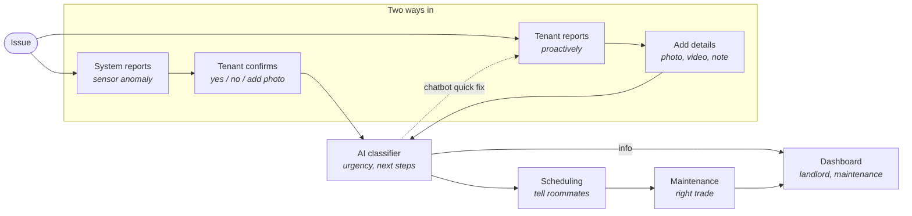
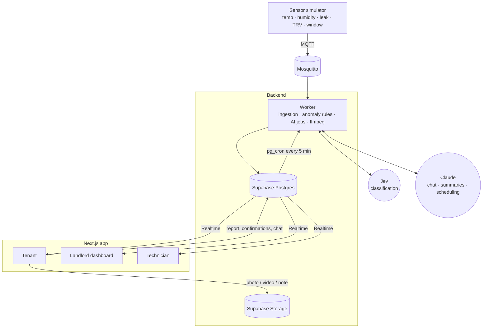
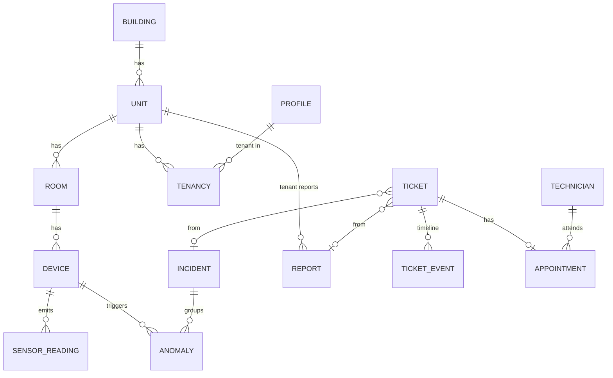
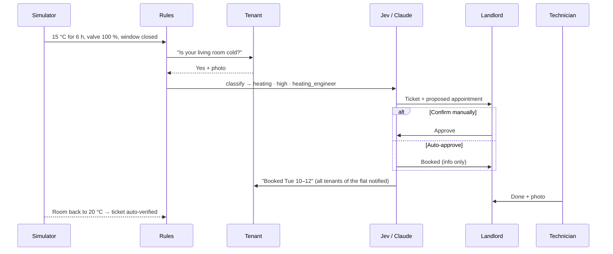

# Architecture & Tech Stack

> **Scope:** this is a **basic prototype** for a group project, not a production system.
> It follows the flow diagram below. We keep the moving parts to a minimum and use
> simulated sensors, so the whole flow can be demoed on a laptop.

## 1. Idea in one paragraph

Today, rental housing maintenance only happens after something goes wrong. Tenants email, wait, and never know when someone will come. Landlords get unstructured reports and only notice damage once it is expensive to fix. We give each flat a "nervous system" of IoT sensors (simulated in the prototype) and add an AI layer that **detects** problems early, **asks the tenant to confirm**, **turns** a photo or video report into a structured ticket, **groups** related issues across flats, and **acts**: it prioritises the ticket, books the right trade, and keeps everyone informed.

## 2. Flow (scope)



| Diagram box | Where it lives in the system | Section |
|---|---|---|
| System reports | Sensor simulator + anomaly rules | §5.1, §5.2 |
| Tenant confirms | Confirmation prompt in the tenant app (yes / no / photo) | §5.3 |
| Tenant reports / Add details | Tenant web app capture flow | §5.3, §5.4 |
| AI classifier | Jev for classification, Claude for text tasks | §5.5 |
| Chatbot quick fix | Chat in the tenant app | §5.6 |
| Scheduling | In-app booking + roommate notifications | §5.7 |
| Maintenance | Technician view, matched by trade | §5.7 |
| Dashboard | Landlord / maintenance dashboard (live updates) | §5.8 |

## 3. Stack at a glance

The project uses **one language (TypeScript)** and **one managed backend (Supabase)**, so the team spends time on the idea rather than on infrastructure.

| Layer | Choice | Why |
|---|---|---|
| Language | **TypeScript** (Node 22 LTS) | One language for the web app, worker and AI code |
| Repo | **pnpm workspaces** | Web app and worker share types and the database client |
| Web app (tenant + landlord + technician) | **Next.js (App Router)**, mobile-friendly, installable as a PWA | One codebase with role-based views. Phone camera works in the browser |
| UI | **Tailwind CSS + shadcn/ui**, **Recharts** for sensor charts | Fast to build |
| Database | **Supabase Postgres** | Tickets, users and sensor readings in one place |
| Auth & access | **Supabase Auth** + Row-Level Security | Tenants only see their own flat |
| Media storage | **Supabase Storage** (private bucket) | Photos and videos |
| Live updates | **Supabase Realtime** | Dashboard and ticket status update without refresh |
| Background jobs | **Supabase Cron (pg_cron)** + a small **Node worker** | Periodic anomaly checks, AI calls |
| Sensors | **Sensor simulator** publishing over **MQTT** (local Mosquitto) | Realistic data and injectable faults, no hardware needed |
| Classification | **TypeSafe Jev** (`@typesafe-ai/sdk`) | Typed answers + confidence for category, urgency and trade, at a fraction of LLM cost |
| Text AI | **Claude API** (`@anthropic-ai/sdk`), model `claude-opus-5-5` | Chatbot, ticket summaries, scheduling agent, fallback when Jev is unsure |
| Video handling | **ffmpeg** in the worker | Pulls a few still frames from a tenant video |
| Notifications | **In-app** (Realtime + browser push) and **email** (Resend) | Tenant confirmations, roommate notices, technician jobs |
| Hosting | **Vercel** (web), **Supabase Cloud** (data), worker runs locally or on a free container tier | Free tiers are enough |

## 4. System architecture



**Principle:** rules **detect**, AI **interprets and acts**, humans **validate**.

## 5. Components

### 5.1 Sensors (simulated)

- `tools/sensor-sim` publishes readings for a few fake flats every few seconds. Topics follow `building/{b}/unit/{u}/room/{r}/{type}`.
- Each fault scenario can be triggered from a CLI flag or a small admin button: stuck radiator valve, leak, humidity creep, and a whole floor going cold (boiler failure).
- The worker subscribes to the broker, validates each message with Zod, and inserts rows into `sensor_readings`.

### 5.2 Anomaly rules ("System reports")

A plain TypeScript rule set, run every 5 minutes. No AI is needed to *detect* problems:

| Rule | Condition | Severity |
|---|---|---|
| Leak | Leak sensor wet | critical |
| Heating fault | Room < 17 °C for ≥ 3 h, valve open ≥ 80 %, window closed | high |
| Mould risk | Humidity > 70 % for most of the last 72 h | medium |
| Sensor offline | No reading for > 2× the reporting interval | low |

**Grouping:** if several flats on the same floor raise the same anomaly within an hour, they are attached to **one incident**, which produces one ticket ("likely boiler or riser").

Each anomaly stores the evidence behind it (readings + rule name). The tenant prompt and the dashboard show this evidence.

### 5.3 Tenant app ("Tenant confirms" / "Tenant reports")

- **Confirm** (sensor-initiated): *"Your living room has been at 15 °C for 6 h with the heating on. Is it cold?"* → **Yes / No / Add photo**. *No* closes the anomaly as a false alarm. If there is no answer, `high` and `critical` issues are escalated anyway.
- **Report** (tenant-initiated): take a photo or a short video and optionally add a text note. No forms.
- **Status timeline** per ticket (received → classified → booked → resolved), updated live.

### 5.4 Media handling ("Add details")

| Input | Processing |
|---|---|
| Photo | Resize to ≤ 1568 px on the long edge |
| Video (≤ 30 s) | ffmpeg extracts ~4 still frames, which are then treated as photos |
| Text note | Used as is |

### 5.5 AI layer ("AI classifier")

We split the work by what each model is good at:

- **Jev** (TypeSafe AI) makes the **bounded decisions**. It doesn't generate text. It answers declared questions with typed values plus a confidence score, which is much cheaper than calling an LLM for every report.
- **Claude** handles the jobs that need **language or multi-step actions**: writing the ticket summary, the quick-fix chat, the scheduling agent, and a second opinion when Jev is unsure.

**Questions Jev answers for every report or anomaly:**

| Field | Type | Values |
|---|---|---|
| `category` | choice | heating, plumbing, leak, electrical, mould_damp, windows_doors, appliance, other |
| `trade` | choice | plumber, heating_engineer, electrician, handyman, damp_specialist |
| `urgency` | choice | critical, high, medium, low |
| `self_fixable` | yes/no | Can the tenant safely fix it with a guide? |
| `safety_risk` | yes/no | Gas, live electrics, major water ingress |
| `needs_access` | yes/no | Does a technician need to enter the flat? (triggers roommate notice) |

**Routing logic:**

```
report / anomaly
   │
   ▼
Jev classify (text note + sensor evidence, photos if enabled)
   │
   ├─ every confidence ≥ 0.8 ──► create ticket ──► Claude writes 2-line summary
   │
   └─ any confidence < 0.8 ───► Claude classifies instead (same fields, structured output)
                                 └─ still unsure ──► tenant gets a follow-up question
```

**Caveats about Jev to keep in mind:**

- Jev is **new (early access since Sept 2026)**, and its **image input is an experimental preview** (Jev 1.14, enabled with an opt-in header) that TypeSafe says is less reliable than text. For the prototype we send photos to Jev with that feature on. If results look poor in testing, we send photo-only reports straight to Claude, which handles images natively.
- The cost advantage comes from the vendor's own numbers. We'll log the cost of every call (`ai_calls` table) so we can compare it ourselves.
- Check exact SDK calls and header names against TypeSafe's own docs before building, since most coverage so far is secondary.

**Claude settings:**

| Setting | Value |
|---|---|
| Model | `claude-opus-5-5` |
| Effort | `low` for summaries and fallback classification, `medium` for chatbot and scheduler (always set explicitly: this model's default is `medium` and thinking can't be turned off) |
| Structured output | `client.messages.parse` + Zod schema, so tickets are never parsed from free text |
| Tools | `tool_choice: "auto"` + `strict: true` (forced tool choice is not supported on this model) |
| Refusals | Check `stop_reason === "refusal"` before reading content. If a call is refused or fails, the ticket goes to the landlord's "needs triage" column |

**Safety guardrail:** the rules always win. A leak sensor or keywords such as "gas" or "sparks" force `critical` + `safety_risk`, whatever the AI says.

### 5.6 Chatbot quick fix (dashed arrow)

When `self_fixable = yes` and `safety_risk = no` (examples: bleeding a radiator, resetting a tripped switch, a TRV with flat batteries), the tenant gets a **guided chat with Claude** before any ticket is created.

- The chat is grounded in a few how-to guides per flat (markdown files written by the landlord).
- Claude has three tools: `create_ticket`, `request_photo` and `mark_resolved`. Every chat ends either **resolved** or **ticket created**.
- For sensor issues, the system checks the readings after "fixed". If the room is still cold after 2 h, the issue reopens.

### 5.7 Scheduling & maintenance ("Tell roommates" / "Right trade")

Scheduling happens **entirely inside the app**. There is no external calendar.

- `technicians` have a trade and weekly availability slots that they manage in the app.
- The **Claude scheduler** uses tools: `find_technicians(trade)` → `get_free_slots(...)` → `propose_appointment(...)`.
- **Landlord approval setting** (per landlord, in the dashboard settings):

  | Setting | Behaviour |
  |---|---|
  | **Confirm manually** | The maintenance job and proposed appointment wait in the dashboard until the landlord approves (or changes the slot or technician) |
  | **Auto-approve** | The system books the job and appointment immediately. The landlord is informed and can still cancel |

- Once booked, **all tenants of the flat** are notified (time window, room, whether access is needed), and the technician sees the job.
- **Technician view:** job list with photos, ticket summary and sensor evidence, plus "on my way" / "done + photo" buttons.

### 5.8 Dashboard (landlord & maintenance)

- **Overview:** flats colour-coded by open issues.
- **Ticket board:** new → awaiting approval → scheduled → in progress → resolved, with a "needs triage" column for anything the AI couldn't classify.
- **Incidents:** grouped issues, e.g. "4 flats, floor 2, heating".
- **Sensor charts** per room.
- **Settings:** the approval mode from §5.7.
- **One headline metric:** issues caught by sensors before any tenant reported them.

## 6. Data model (core tables)



| Table | Key columns |
|---|---|
| `profiles` | `role` (`tenant` / `landlord` / `technician`), `auto_approve` (landlords only) |
| `buildings`, `units`, `rooms` | Including `floor` (used for grouping) |
| `devices`, `sensor_readings` | `type`, `room_id`; readings are `device_id`, `ts`, `metric`, `value` |
| `anomalies`, `incidents` | `rule`, `severity`, `evidence jsonb`, `tenant_confirmation`, `incident_id` |
| `reports` | Note, media paths, extracted frames |
| `tickets` | Classification fields, `summary`, `status`, `source` (`sensor` / `tenant` / `chat`), `classified_by` (`jev` / `claude` / `landlord`) |
| `ticket_events` | Timeline entries |
| `technicians`, `availability`, `appointments` | In-app scheduling, `approved_by` |
| `ai_calls` | Provider, model, input/output, confidence, cost, latency |

## 7. Example flows

**A. Sensor-detected heating fault**



**B. Tenant photo of a leak:** photo + note "water dripping from bathroom ceiling" → Jev: `leak · critical · plumber` (confidence 0.93) → ticket + Claude summary → booked according to the landlord's approval setting.

**C. Quick fix:** photo of a radiator that is cold at the top → Jev: `self_fixable = yes` → chatbot guides the tenant through bleeding it → tenant marks it fixed → sensors confirm the room warming up → no ticket needed.

## 8. Repository layout

```
/
├─ apps/
│  ├─ web/          # Next.js: tenant, landlord, technician views
│  └─ worker/       # MQTT ingestion, anomaly rules, AI calls, ffmpeg
├─ packages/
│  ├─ db/           # Supabase migrations, seed data, generated types
│  └─ ai/           # Jev questions, Claude prompts, Zod schemas, routing
├─ tools/
│  └─ sensor-sim/   # Simulator with fault scenarios
└─ architecture.md
```

## 9. Basic security & privacy

- API keys live only in server-side environment variables, never in the browser.
- Row-Level Security: tenants see their own flat, technicians see their assigned jobs, landlords see their own buildings.
- Media is stored in a private bucket and served through short-lived signed URLs.
- Only the minimum context is sent to Jev and Claude (no names or contact details).
- All demo data is fake.

## 10. Build plan

| Step | Goal |
|---|---|
| 1 | Repo, Supabase schema, login with three roles, simulator → readings → charts |
| 2 | Tenant reports (photo/video/note) → Jev classification → ticket board |
| 3 | Anomaly rules, tenant confirmation, incident grouping |
| 4 | In-app scheduling, approval setting, roommate notifications, technician view |
| 5 | Quick-fix chatbot, sensor-verified resolution, demo script |
