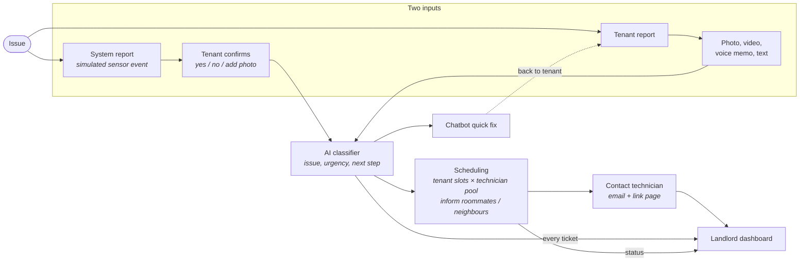
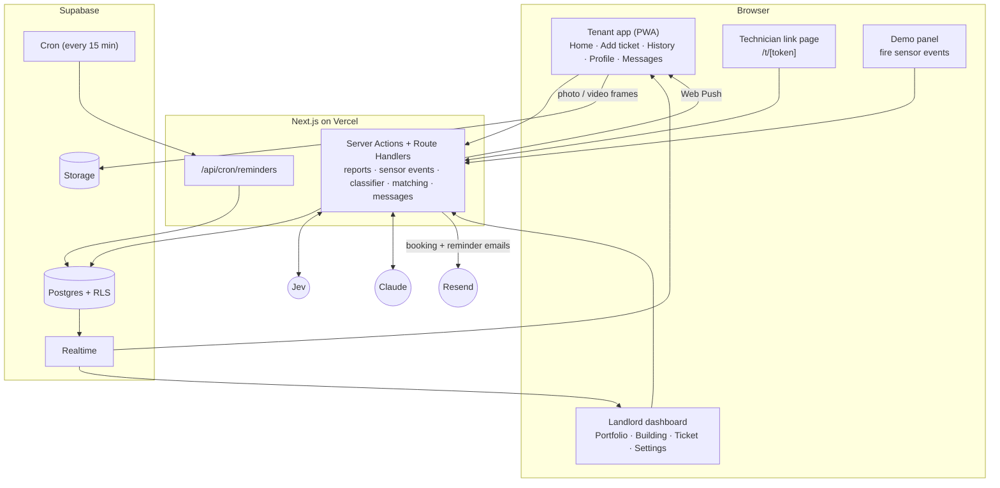
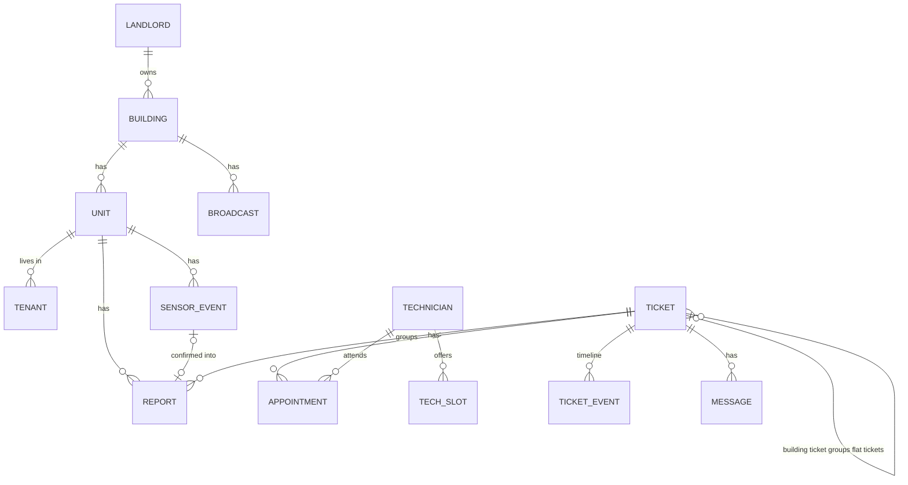
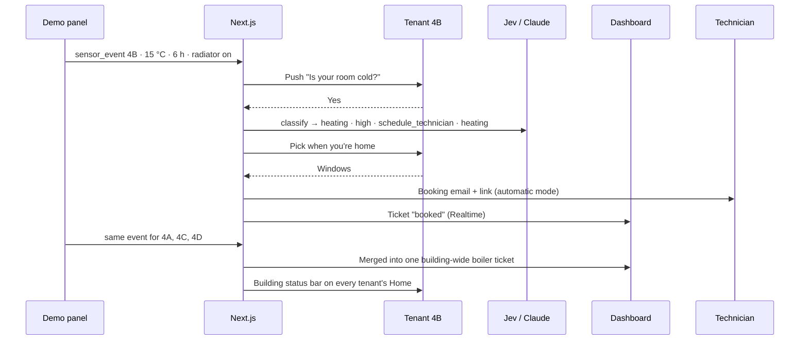

# Architecture & Tech Stack

> **Scope:** this is a **basic prototype (MVP)** for a group project, not a production system.
> What we build and why is defined in [`product.md`](product.md). This file describes **how** it is built.
> The research behind it is in [`evidence.md`](evidence.md) (Issues 1–12).

## 1. MVP in one paragraph

The product is one web app with two faces. Tenants get a **mobile-first app** to report problems with a photo, video, voice memo or text, and to confirm simulated sensor alerts. Landlords get a **problem-first dashboard** across their portfolio. An AI classifier turns every report into a ticket and then does one of four things: sends a **quick fix** through the chatbot, **books a technician** from a shared pool against the tenant's availability, **logs it** for the landlord, or **dismisses** it. Technicians have no app. They get an email with a private link to a single page. Sensors are **simulated** from a demo panel.

**MVP focus** (from `product.md` §6): simulated sensors, the tenant self-reporting flow end to end, and the landlord dashboard.

### What the evidence asks of the design

| Evidence | Design decision | Where |
|---|---|---|
| Damp/mould, heating and leaks are the most common defects (Issues 1, 8) | Sensor presets and MVP issue types: water, heating, mould, electricity, small defects | §5.1, §5.4 |
| Tenants hesitate to complain (Issue 6) | The system asks first ("Is your room cold?"); one-tap photo, video or voice reporting, no forms | §5.2, §5.3 |
| No acknowledgement, constant chasing (Issue 3) | "Received, we're on it" on upload; four-stage progress on every ticket; status questions answered by the chatbot | §5.3, §5.6 |
| The same communal fault is reported many times (Issue 5) | Related reports join one ticket; building-wide tickets show as a status bar on every tenant's Home | §5.5 |
| Most missed appointments happen because the tenant didn't know (Issue 4) | Tenant picks their own slots, gets reminders and confirms "I'll be home" | §5.7 |
| Most delay is coordination, not repair (Issues 9, 10) | Automatic matching and booking by default; landlord only monitors | §5.7 |
| Landlords are judged on target times (Issue 12) | Every ticket gets a due time from its urgency; the dashboard shows overdue tickets | §5.8 |

## 2. Flow



| `product.md` workflow step | Built as | Section |
|---|---|---|
| 1a. System report | Demo panel inserts a `sensor_event` | §5.1 |
| 1b. Tenant confirms | Push + in-app prompt: Yes / No / Add photo | §5.2 |
| 2a. Tenant report | Add-ticket screen (photo, video, voice memo, text) | §5.3 |
| 3. AI classifier | Jev + Claude, with safety rules | §5.4 |
| 4a. Quick fix | Claude chatbot in Messages | §5.6 |
| 4b. Scheduling | Tenant availability matched to the technician pool by code | §5.7 |
| 5. Contact maintenance | Booking email with a private technician link page | §5.7 |
| 6. Dashboard | Portfolio → building → ticket detail | §5.8 |
| 7. Resolution | Technician taps "done", the ticket closes and moves to the tenant's History | §5.7 |

## 3. Stack at a glance

One language (**TypeScript**), one app (**Next.js**) and one managed backend (**Supabase**). There are no separate servers to run.

| Layer | Choice | Why |
|---|---|---|
| Language | **TypeScript** | One language for the UI, server code and AI code |
| App | **Next.js (App Router)** on **Vercel** | Tenant app, landlord dashboard, technician pages and API routes in one codebase. Server Actions and Route Handlers hold all backend logic |
| Tenant app | The same Next.js app, mobile-first and **installable as a PWA** | Phone camera, microphone and push notifications in the browser, no app store |
| UI | **Tailwind CSS + shadcn/ui**, **Recharts** for KPI charts | Fast to build |
| Database | **Supabase Postgres** | All data in one place |
| Auth & access | **Supabase Auth** (email + password) + Row-Level Security | Landlords and tenants log in. Technicians don't have accounts (§5.7) |
| Media | **Supabase Storage** (private bucket, signed URLs) | Photos, videos, video frames |
| Live updates | **Supabase Realtime** | Ticket progress, dashboard and home-screen status bars update without refresh |
| Scheduled jobs | **Supabase Cron** calling one API route every 15 min | Appointment reminders |
| Classification | **TypeSafe Jev** (`@typesafe-ai/sdk`) | Typed answers + confidence for the classifier's fixed-choice fields, much cheaper than an LLM |
| Text AI | **Claude API** (`@anthropic-ai/sdk`), model `claude-opus-5-5` | Ticket summaries, quick-fix text, chatbot, fallback classification |
| Voice memos | Browser **Web Speech API** | Transcribed live on the phone. No speech-to-text service |
| Video | Browser `<video>` + `<canvas>` | ~4 still frames are extracted on the phone before upload. No ffmpeg |
| Notifications | **In-app** (Realtime), **Web Push** for tenants, **email** via Resend | Sensor confirmations, booking notices, broadcasts, technician bookings, reminders |
| Hosting | **Vercel** + **Supabase Cloud** free tiers | Enough for the prototype |

## 4. System architecture



**Principle:** the AI **classifies and drafts**, code **decides and books**, humans **confirm**.

## 5. Components

### 5.1 Simulated sensors (demo panel)

There is no hardware, MQTT or stream of readings. The demo panel (`/demo`, landlord accounts only, hidden in production) **inserts one `sensor_event` row per click**. Each row is already an anomaly, e.g. *Flat 4B, temperature 15 °C for 6 h, radiator on*.

| Preset | Event | Issue type |
|---|---|---|
| Cold room | Temperature 15 °C for 6 h, radiator valve open | heating |
| Boiler failure | Fires "cold room" for every flat on one floor (e.g. 4A–4D) | heating, building-wide |
| Leak | Leak detector wet | water |
| No hot water | Hot-water pipe below 30 °C for 2 h | water |
| Mould risk | Humidity > 70 % for 3 days | mould |

The panel lets you pick building, flat and preset, and shows the resulting tenant prompt and ticket live. That's all the demo script (`product.md` §14, steps 7–10) needs.

### 5.2 Tenant confirmation ("Tenant confirms")

1. A new `sensor_event` sends the flat's tenants a **push notification** plus a card on Home: *"Is your living room cold? It has been 15 °C for 6 hours with the radiator on."* → **Yes / No / Add photo**.
2. **No** → the event is marked `dismissed`. Nothing reaches the landlord. It shows in the tenant's History.
3. **Yes / Add photo** → a `report` with `source = sensor` is created (plus the photo, if added) and goes to the classifier (§5.4).
4. Leak prompts are marked urgent and stay pinned at the top of Home until answered.

### 5.3 Tenant app

Mobile-first. Bottom navigation: **Home · Add ticket · History · Profile · Messages** (`product.md` §8).

**Add ticket**: three big buttons and an optional text field. No form fields.

| Input | What happens on the phone | What is stored |
|---|---|---|
| Photo | Resized to ≤ 1568 px on the long edge | Image in Storage |
| Video (≤ 30 s) | ~4 still frames extracted with `<video>` + `<canvas>` | Video + frames in Storage. Only the frames go to the AI |
| Voice memo | Transcribed live by the Web Speech API while recording | **Transcript only**, shown in ticket detail. The audio isn't kept |
| Text | — | Text |

The Web Speech API works in Chrome and Safari, but Chrome sends the audio to Google for recognition. Browsers without it (e.g. Firefox) show only the text field.

**On upload:** the tenant immediately sees **"Received, we're on it"** and the ticket appears in Home and History (status `logged`). Classification runs right after the response (Next.js `after()`), and the result arrives over Realtime within seconds:
- quick fix → a chatbot message with the fix (§5.6)
- technician needed → the **availability picker** opens (§5.7)

**Home:**
- pinned **landlord broadcast** (latest one for the building)
- **building-wide status bar** for any open ticket with `scope = building`, showing its stage
- **my tickets** with a progress indicator
- **quick add** button
- open **sensor confirmation** cards

**Progress indicator** (four stages, derived from ticket and appointment status):

| Stage shown to tenant | Ticket status |
|---|---|
| 1. Repair logged | `logged`, `confirmed`, `quick_fix` |
| 2. Technician appointment booked | `booked` |
| 3. Fix in progress | `in_progress` |
| 4. Resolved | `resolved` |

**History:** past tickets (status, date, media, outcome) plus confirmed and dismissed sensor alerts.
**Profile:** personal details, password, linked building and apartment.
**Messages:** landlord broadcasts and ticket messages, technician updates, and the chatbot.

### 5.4 AI classifier

Implements the spec in `product.md` §11. **Jev** answers the fixed-choice fields with a confidence score. **Claude** writes the free-text fields and steps in when Jev is unsure. Code fills in what is already known.

| Field | Values | Decided by |
|---|---|---|
| `issue_type` | water · heating · mould · electricity · defect · other | Jev |
| `location` | building, apartment, room (if given) | Building and apartment come from the tenant's account or the sensor event. Room is read from the text by Claude |
| `scope` | apartment · building | Jev, overridden by building grouping (§5.5) |
| `urgency` | emergency · high · medium · low | Jev, never below the safety floor (below) |
| `next_step` | quick_fix · schedule_technician · inform_landlord · dismiss | Jev |
| `trade` | plumber · heating · electrician · handyman · none | Jev |
| `quick_fix_text` | Step-by-step guide | Claude, only if `next_step = quick_fix` |
| `related_tickets` | Open tickets in the same building | Jev picks from a list of the building's open tickets built by code (or "none") |
| `summary` | One sentence for the dashboard | Claude |

**Input:** text (note or voice transcript), image frames, and context built by code: the flat's floor, the building's open tickets, and sensor event details. Jev reads images through its experimental image preview (see caveats).

**Routing:**

```
report (tenant or confirmed sensor event)
   │
   ▼
safety rules ── gas / smoke / sparks / leak sensor ──► urgency = emergency + on-screen safety advice
   │
   ▼
Jev: issue_type, scope, urgency, next_step, trade, related_tickets
   │
   ├─ all confidences ≥ 0.8 ──► Claude (effort low): summary, room, quick_fix_text
   └─ any confidence  < 0.8 ──► Claude (effort low) classifies all fields (structured output)
                                 └─ still unsure ──► ticket goes to "needs triage" on the dashboard
```

**Safety floor:** a leak sensor, or words like "gas", "smoke", "sparks" or "burning", force `urgency = emergency`, whatever the AI says. Gas or smoke also shows an on-screen instruction to leave the flat and call 112, before anything else.

**What each `next_step` does:**

| `next_step` | Result |
|---|---|
| `quick_fix` | Ticket status `quick_fix`. The chatbot sends `quick_fix_text` in Messages with "Fixed it" / "Didn't work". "Didn't work" switches to `schedule_technician` |
| `schedule_technician` | The tenant's availability picker opens → matching and booking (§5.7) |
| `inform_landlord` | Ticket stays `logged` and appears on the dashboard without a booking (e.g. cosmetic damage kept for the next planned visit) |
| `dismiss` | Ticket status `dismissed`, with a short reason for the tenant. Visible in History |

**Jev caveats:**
- Jev has been in **early access since Sept 2026**, and its **image input is an experimental preview** (Jev 1.14, opt-in header) that TypeSafe says is less reliable than text. If photo-only reports classify poorly in testing, send them straight to Claude, which handles images natively.
- The cost advantage is the vendor's own claim. Every call is logged in `ai_calls` with its cost, so we can check it ourselves.
- Check the exact SDK calls and header names against TypeSafe's docs before building.

**Claude settings:**

| Setting | Value |
|---|---|
| Model | `claude-opus-5-5` |
| Effort | `low` for summaries, quick-fix text and fallback classification; `medium` for the chatbot. Always set it explicitly: the default is `medium`, and thinking can't be turned off on this model |
| Structured output | `client.messages.parse` + a Zod schema shared with the database types |
| Tools (chatbot) | `tool_choice: "auto"` + `strict: true` (forced tool choice isn't supported on this model) |
| Refusals and errors | Check `stop_reason === "refusal"` before reading content. Any failed or refused call sends the ticket to "needs triage" |

### 5.5 Grouping, building-wide tickets and neighbours

- **Tenant reports:** if Jev links a report to an open ticket (`related_tickets`), the report is **attached to that ticket** instead of creating a new one. The tenant sees the existing ticket's progress.
- **Sensor events:** if **3 or more flats in the same building** have a heating event within 1 hour and at least one tenant has confirmed, code merges them into **one ticket with `scope = building`** (the "boiler ticket"). The flat tickets are attached to it, and one technician visit covers all of them.
- **Building status bar:** every open ticket with `scope = building` appears on **every tenant's Home** in that building, with its stage.
- **Neighbours below:** for a water ticket, the flat **one floor down in the same position** (e.g. 2B → 1B) gets a notification right away: *"Water leak reported in the flat above. Check your ceiling and tell us if you see water."* Units store `floor` and `position` for this.

### 5.6 Chatbot (Messages)

A Claude chat in the Messages tab, at effort `medium`. It handles:
- **Quick fixes:** step-by-step guides (bleeding a radiator, resetting a tripped switch, re-sealing a window), grounded in a small set of guides per building written by the landlord (markdown).
- **"Why is my room cold?"** answered from the tenant's own sensor events and tickets.
- **Status questions** answered from ticket and appointment data, so the tenant doesn't have to chase the landlord.

**Tools:**
- `get_my_tickets`: the tenant's tickets and appointments
- `escalate_to_technician`: switches a quick fix to scheduling
- `mark_fixed`: closes a quick-fix ticket

**Limits:** no gas, electrical or structural DIY. Every quick fix ends either **fixed** or **escalated**.

### 5.7 Scheduling, technician pool and visits

**Technician pool:** one shared pool of technicians, seeded for the demo. Each has a trade, contact details and availability slots. Whether landlords bring their own technicians is still open (`product.md` §10).

**Technicians have no accounts.** Each technician has a long random **link token**. Every email to them contains a link to `/t/[token]`, a single page where they can:
- set or update their **availability** (weekly time slots)
- see their **jobs** (media, location, summary, slot)
- tap **Confirmed / Running late / On site / Done**. Each tap posts a message to the tenant's Messages and updates the ticket

**Matching and booking** (plain code, no AI):

1. The classifier picks `schedule_technician`, and the tenant marks when they're home (2-hour windows over the next 7 days; slots before the due time are highlighted).
2. Code finds the **earliest overlap** between the tenant's windows and a free slot of a technician with the right `trade`.
3. **Automatic mode** (default): the appointment is `booked` straight away. **Manual mode:** it's `proposed` and waits on the dashboard until the landlord confirms it or picks another slot or technician.
4. On booking, the **technician gets an email** with the job and their link, **all tenants of the flat** (roommates) are told the slot, and the ticket moves to `booked`. For a building-wide ticket, every affected flat is told.
5. If there's no overlap, the tenant is asked for more windows and the ticket is flagged on the dashboard.

**Reminders** (Supabase Cron → `/api/cron/reminders`, every 15 min) go out the evening before and 1 hour before the slot, by push and email. The tenant answers **"I'll be home" / "Someone else will let them in" / "Reschedule"**. "Reschedule" reopens the availability picker and frees the slot. The technician is notified.

**Visit outcomes:** "On site" sets the ticket to `in_progress`. "Done" asks for an outcome:

| Outcome | Effect |
|---|---|
| `completed` | Ticket → `resolved` and moves to the tenant's History |
| `needs_follow_up` | Parts or a second visit needed. The tenant gets the availability picker again for a new appointment |
| `no_access` | Nobody let them in. Re-booked through the tenant's availability picker. Counts as a missed appointment on the dashboard |

### 5.8 Landlord dashboard

Problem-first, not tenant-first (`product.md` §9). Names and phone numbers only appear in the ticket detail.

| Screen | Route | Content |
|---|---|---|
| **Portfolio** | `/dashboard` | List of buildings (name, address, units, open/resolved tickets). Custom problem bar: the landlord picks which stats are shown (open, overdue, emergencies, avg. time to fix), and buildings well above the portfolio average are flagged. "Message building" button |
| **Building** | `/dashboard/buildings/[id]` | KPI bar. Pipeline of tickets by stage. Problem list ranked by urgency, then due time (issue, stage, urgency, overdue marker). Tenants list (secondary). Master message bar at the bottom → broadcast |
| **Ticket detail** | `/dashboard/tickets/[id]` | Media and voice transcript, classification + urgency (editable), reporter (flat, name, contact), linked reports, technician + appointment, progress % (25/50/75/100 by stage), timeline, ticket messages. In manual mode: confirm / change the proposed appointment |
| **Settings** | `/dashboard/settings` | Mode (automatic / manual), due times per urgency, quick-fix guides per building |
| **Properties** | `/dashboard/buildings/new`, `/dashboard/buildings/[id]/invite` | Register buildings and units, generate the tenant invite link/code |

**Due times:** each ticket gets `due_at` from its urgency on creation. Defaults follow the UK median repair targets (evidence Issue 12): **24 h for emergency and high, 28 days for medium and low**. They can be changed in Settings. The dashboard shows "due soon" and "overdue".

**KPI bar** (`product.md` §13):

| KPI | Computed from |
|---|---|
| **Time from issue to fix** (main KPI) | `resolved_at − occurred_at`. `occurred_at` is when the sensor event started, or when the tenant reported |
| Open vs. resolved | Ticket status |
| Overdue tickets | `due_at < now()` and not resolved |
| Technician visits / missed appointments | `appointments`, `outcome = no_access` |
| Handled without the landlord | Tickets with no landlord action (automatic mode, no edits). A stand-in for "time saved" |

Costs and tenant retention are not measured in the MVP (no payments, no lease data).

### 5.9 Onboarding

1. The landlord signs up. The account gets a licence flag (no payment in the MVP).
2. The landlord adds buildings and units (floor + position, e.g. 4B).
3. Each building gets an **invite link with a code**: `/join/[code]`.
4. The tenant opens the link, picks their apartment from the building's list, and creates an account (email, phone, password).
5. The account is tied to that unit, so reports and sensor alerts are located automatically, and broadcasts and building-wide notices reach the right people.

## 6. Pages and routes

| Who | Route | Page |
|---|---|---|
| Tenant | `/join/[code]` | Sign-up from the invite link |
| Tenant | `/app` | Home |
| Tenant | `/app/new` | Add ticket |
| Tenant | `/app/history` | History |
| Tenant | `/app/messages` | Messages + chatbot |
| Tenant | `/app/profile` | Profile |
| Tenant | `/app/tickets/[id]` | Ticket progress, availability picker, appointment confirmation |
| Landlord | `/dashboard`, `/dashboard/buildings/[id]`, `/dashboard/tickets/[id]`, `/dashboard/settings` | See §5.8 |
| Technician | `/t/[token]` | Availability, jobs, status buttons (no login) |
| Demo | `/demo` | Sensor event panel |
| System | `/api/cron/reminders` | Called by Supabase Cron (protected with a shared secret) |

After login, the user's role (`landlord` / `tenant`) sends them to `/dashboard` or `/app`.

## 7. Data model

Based on `product.md` §12, with three additions:
- an `appointments` table, because a ticket can need several visits (follow-up, no access)
- `ticket_events` for the timeline
- `ai_calls` to log every AI call



| Table | Key columns |
|---|---|
| `landlords` | `id`, `user_id`, `licence_active`, `mode` (`automatic` / `manual`), `due_hours` per urgency |
| `buildings` | `id`, `landlord_id`, `name`, `address`, `invite_code` |
| `units` | `id`, `building_id`, `floor`, `position`, `number` (e.g. "4B") |
| `tenants` | `id`, `user_id`, `unit_id`, `name`, `email`, `phone` |
| `technicians` | `id`, `name`, `trade`, `email`, `phone`, `link_token` |
| `tech_slots` | `technician_id`, `starts_at`, `ends_at` |
| `sensor_events` | `id`, `unit_id`, `metric`, `value`, `duration`, `occurred_at`, `confirmation` (`pending` / `yes` / `no`), `simulated = true` |
| `reports` | `id`, `unit_id`, `tenant_id`, `source` (`tenant` / `sensor`), `sensor_event_id`, `text`, `transcript`, `media_paths`, `frame_paths`, `created_at`, `ticket_id` |
| `tickets` | `id`, `building_id`, `unit_id` (null if building-wide), `parent_ticket_id`, classifier fields (`issue_type`, `room`, `scope`, `urgency`, `next_step`, `trade`, `quick_fix_text`, `summary`), `classified_by` (`jev` / `claude` / `landlord`), `status` (`logged` / `confirmed` / `quick_fix` / `booked` / `in_progress` / `resolved` / `dismissed`), `needs_triage`, `occurred_at`, `due_at`, `resolved_at` |
| `appointments` | `id`, `ticket_id`, `technician_id`, `starts_at`, `ends_at`, `status` (`proposed` / `booked` / `cancelled` / `done`), `tenant_reply` (`home` / `someone_else` / `reschedule`), `outcome` (`completed` / `needs_follow_up` / `no_access`), `reminders_sent` |
| `tenant_windows` | `ticket_id`, `tenant_id`, `starts_at`, `ends_at` (the tenant's availability for that ticket) |
| `ticket_events` | `ticket_id`, `type`, `actor` (`ai` / `tenant` / `landlord` / `technician` / `system`), `data`, `created_at` |
| `messages` | `id`, `ticket_id`, `from` (`ai` / `tenant` / `landlord` / `technician`), `text`, `created_at` |
| `broadcasts` | `id`, `building_id`, `landlord_id`, `text`, `created_at` |
| `ai_calls` | `provider`, `model`, `purpose`, `input_ref`, `output`, `confidence`, `cost`, `latency_ms` |

## 8. Example flows

**A. Sensor path with building grouping** (demo script steps 7–10)



**B. Tenant voice memo, high priority** (demo script steps 3–6): the tenant records *"The pipe under my kitchen sink is dripping, there's water on the floor"* → the transcript is uploaded → "Received, we're on it" → classifier: `water · high · schedule_technician · plumber` → the flat below is notified → the tenant picks windows → a plumber is booked → the dashboard shows the new high-priority ticket and the KPI bar updates.

**C. Low priority:** a photo of scraped paint → `defect · low · inform_landlord` → logged on the dashboard for the next planned visit, not in the urgent list. (Or `quick_fix` → the chatbot sends a touch-up guide.)

**D. Tenant says no:** sensor event → "Is your room cold?" → **No** → event dismissed, nothing reaches the landlord.

**E. Missed visit:** reminder sent → no reply → the technician taps Done → `no_access` → the tenant gets the availability picker again, and the dashboard counts a missed appointment.

## 9. Out of scope (MVP)

As in `product.md` §6:
- Real sensor hardware and integrations (simulated events only)
- Shared-space issues (e.g. rubbish in common areas)
- A technician app or technician accounts (only the link page in §5.7)
- Payments, invoicing, rent and contracts
- Cross-building ML prediction

## 10. Repository layout

```
/
├─ app/
│  ├─ (tenant)/app/...       # Home, Add ticket, History, Messages, Profile
│  ├─ (landlord)/dashboard/...
│  ├─ join/[code]/           # Tenant onboarding
│  ├─ t/[token]/             # Technician link page
│  ├─ demo/                  # Sensor event panel
│  └─ api/cron/reminders/
├─ lib/
│  ├─ ai/                    # Jev questions, Claude prompts, Zod schemas, routing, safety rules
│  ├─ scheduling/            # Matching, booking, reminders
│  ├─ grouping/              # Related tickets, building merge, neighbours
│  └─ supabase/              # Clients, generated types
├─ supabase/
│  ├─ migrations/            # Schema + RLS policies
│  └─ seed.sql               # Demo landlord, "Alexanderplatz 1", units, tenants, technicians
├─ product.md
├─ architecture.md
└─ evidence.md
```

## 11. Security & privacy

- API keys live only in server-side environment variables, never in the browser.
- **Row-Level Security:**
  - tenants see their own unit's tickets, building-wide tickets in their building, their building's broadcasts, and their own messages
  - landlords see only their own buildings
- **Technician pages** use a long random token and are served only through server code. Each page shows only that technician's jobs. Contact details are the minimum needed (flat, slot, tenant first name and phone).
- Media sits in a private bucket and is served through short-lived signed URLs.
- Only the minimum context goes to Jev and Claude (no names or contact details).
- All demo data is fake. Data privacy for real in-flat sensors (GDPR/DSGVO, tenant consent) is an open question for after the MVP (`product.md` §15).

## 12. Build plan

| Step | Goal |
|---|---|
| 1 | Next.js + Supabase setup, schema and RLS, seed data, landlord sign-up, buildings and units, invite link, tenant sign-up |
| 2 | Tenant app shell (bottom nav), Add ticket (photo, video frames, voice transcript, text), "Received" confirmation, Home and History |
| 3 | Classifier (safety rules → Jev → Claude), next-step handling, due times, Realtime progress |
| 4 | Landlord dashboard: Portfolio, Building view with KPI bar and problem list, Ticket detail, Settings, broadcasts |
| 5 | Demo panel, tenant confirmation, grouping into building-wide tickets, building status bar, neighbour notice |
| 6 | Tenant availability, matching and booking, automatic/manual mode, technician link page, booking emails, roommate notices |
| 7 | Reminders, visit outcomes and re-booking, chatbot with quick fixes and status answers, full run-through of the demo script |
